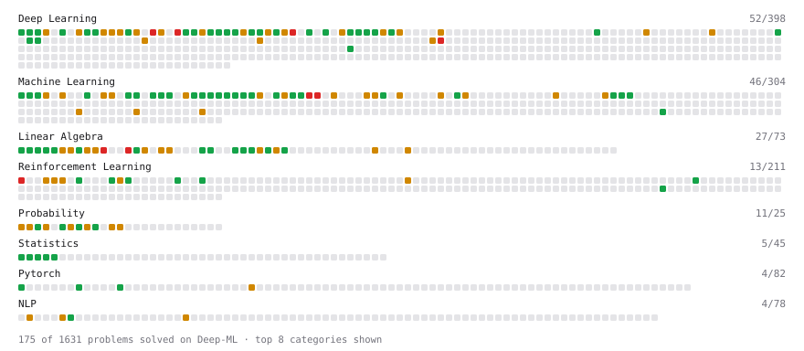

# Deep-ML

My machine learning practice from [Deep-ML](https://www.deep-ml.com). Every solution here was written by hand.

**170** solved · 170 problems · 0 labs · 0 math

[**Browse the interactive portfolio**](https://aymenboustani.github.io/deep-ml/) to replay this filling in over time.

## Problems

| | Difficulty | Solved | |
| --- | --- | --- | --- |
| [Adagrad Optimizer](https://www.deep-ml.com/problems/145) | easy | 2026-05-01 | [solution](problems/0145-adagrad-optimizer) |
| [Adamax Optimizer](https://www.deep-ml.com/problems/148) | easy | 2026-05-02 | [solution](problems/0148-adamax-optimizer) |
| [Backward Pass of Tanh Using Cached Output](https://www.deep-ml.com/problems/999) | easy | 2026-07-01 | [solution](problems/0999-backward-pass-of-tanh-using-cached-output) |
| [Bhattacharyya Distance Between Two Distributions](https://www.deep-ml.com/problems/120) | easy | 2025-04-14 | [solution](problems/0120-bhattacharyya-distance-between-two-distributions) |
| [Binary Classification with Logistic Regression](https://www.deep-ml.com/problems/104) | easy | 2025-03-30 | [solution](problems/0104-binary-classification-with-logistic-regression) |
| [Build an MLP with nn.Sequential](https://www.deep-ml.com/problems/887) | easy | 2026-05-16 | [solution](problems/0887-build-an-mlp-with-nn-sequential) |
| [Calculate 2x2 Matrix Inverse](https://www.deep-ml.com/problems/8) | easy | 2024-09-01 | [solution](problems/0008-calculate-2x2-matrix-inverse) |
| [Calculate Accuracy Score](https://www.deep-ml.com/problems/36) | easy | 2024-08-23 | [solution](problems/0036-calculate-accuracy-score) |
| [Calculate Computational Efficiency of MoE](https://www.deep-ml.com/problems/123) | easy | 2025-04-17 | [solution](problems/0123-calculate-computational-efficiency-of-moe) |
| [Calculate Conditional Probability from Data](https://www.deep-ml.com/problems/168) | easy | 2025-10-31 | [solution](problems/0168-calculate-conditional-probability-from-data) |
| [Calculate Cosine Similarity Between Vectors](https://www.deep-ml.com/problems/76) | easy | 2025-03-28 | [solution](problems/0076-calculate-cosine-similarity-between-vectors) |
| [Calculate Covariance Matrix](https://www.deep-ml.com/problems/10) | easy | 2026-02-18 | [solution](problems/0010-calculate-covariance-matrix) |
| [Calculate Dice Score for Classification](https://www.deep-ml.com/problems/73) | easy | 2025-04-04 | [solution](problems/0073-calculate-dice-score-for-classification) |
| [Calculate F1 Score from Predicted and True Labels](https://www.deep-ml.com/problems/91) | easy | 2025-04-06 | [solution](problems/0091-calculate-f1-score-from-predicted-and-true-labels) |
| [Calculate Image Brightness](https://www.deep-ml.com/problems/70) | easy | 2025-03-27 | [solution](problems/0070-calculate-image-brightness) |
| [Calculate Jaccard Index for Binary Classification](https://www.deep-ml.com/problems/72) | easy | 2025-04-04 | [solution](problems/0072-calculate-jaccard-index-for-binary-classification) |
| [Calculate Mean Absolute Error (MAE)](https://www.deep-ml.com/problems/93) | easy | 2025-02-01 | [solution](problems/0093-calculate-mean-absolute-error-mae) |
| [Calculate Mean by Row or Column](https://www.deep-ml.com/problems/4) | easy | 2024-07-12 | [solution](problems/0004-calculate-mean-by-row-or-column) |
| [Calculate Number of Parameters in Neural Network](https://www.deep-ml.com/problems/371) | easy | 2026-07-17 | [solution](problems/0371-calculate-number-of-parameters-in-neural-network) |
| [Calculate Portfolio Variance](https://www.deep-ml.com/problems/183) | easy | 2025-10-31 | [solution](problems/0183-calculate-portfolio-variance) |
| [Calculate R-squared for Regression Analysis](https://www.deep-ml.com/problems/69) | easy | 2025-02-01 | [solution](problems/0069-calculate-r-squared-for-regression-analysis) |
| [Calculate Root Mean Square Error (RMSE)](https://www.deep-ml.com/problems/71) | easy | 2025-02-01 | [solution](problems/0071-calculate-root-mean-square-error-rmse) |
| [Calculate the Discounted Return for a Given Trajectory](https://www.deep-ml.com/problems/167) | easy | 2026-06-16 | [solution](problems/0167-calculate-the-discounted-return-for-a-given-trajectory) |
| [Calculate the Phi Coefficient](https://www.deep-ml.com/problems/95) | easy | 2025-03-27 | [solution](problems/0095-calculate-the-phi-coefficient) |
| [Calculate Unigram Probability from Corpus](https://www.deep-ml.com/problems/129) | easy | 2025-05-17 | [solution](problems/0129-calculate-unigram-probability-from-corpus) |
| [Compute Discounted Return](https://www.deep-ml.com/problems/165) | easy | 2026-05-18 | [solution](problems/0165-compute-discounted-return) |
| [Compute Multi-class Cross-Entropy Loss](https://www.deep-ml.com/problems/134) | easy | 2026-05-02 | [solution](problems/0134-compute-multi-class-cross-entropy-loss) |
| [Compute PSNR for Image Reconstruction Quality](https://www.deep-ml.com/problems/713) | easy | 2026-04-30 | [solution](problems/0713-compute-psnr-for-image-reconstruction-quality) |
| [Compute Temporal Difference Error](https://www.deep-ml.com/problems/257) | easy | 2026-07-16 | [solution](problems/0257-compute-temporal-difference-error) |
| [Compute the Cross Product of Two 3D Vectors](https://www.deep-ml.com/problems/118) | easy | 2025-04-03 | [solution](problems/0118-compute-the-cross-product-of-two-3d-vectors) |
| [Convert Vector to Diagonal Matrix](https://www.deep-ml.com/problems/35) | easy | 2024-08-22 | [solution](problems/0035-convert-vector-to-diagonal-matrix) |
| [Create a Float Tensor from a Python List](https://www.deep-ml.com/problems/880) | easy | 2026-05-16 | [solution](problems/0880-create-a-float-tensor-from-a-python-list) |
| [Derivative of a Polynomial](https://www.deep-ml.com/problems/116) | easy | 2025-04-03 | [solution](problems/0116-derivative-of-a-polynomial) |
| [Descriptive Statistics Calculator](https://www.deep-ml.com/problems/78) | easy | 2026-02-18 | [solution](problems/0078-descriptive-statistics-calculator) |
| [Dot Product Calculator](https://www.deep-ml.com/problems/83) | easy | 2025-02-01 | [solution](problems/0083-dot-product-calculator) |
| [Dynamic Tanh: Normalization-Free Transformer Activation](https://www.deep-ml.com/problems/128) | easy | 2025-05-06 | [solution](problems/0128-dynamic-tanh-normalization-free-transformer-activation) |
| [Empirical Probability Mass Function (PMF)](https://www.deep-ml.com/problems/184) | easy | 2025-10-16 | [solution](problems/0184-empirical-probability-mass-function-pmf) |
| [Estimate Action Values Using Sample Averaging](https://www.deep-ml.com/problems/543) | easy | 2026-07-22 | [solution](problems/0543-estimate-action-values-using-sample-averaging) |
| [Expected Value and Variance of an n-Sided Die](https://www.deep-ml.com/problems/179) | easy | 2026-05-03 | [solution](problems/0179-expected-value-and-variance-of-an-n-sided-die) |
| [Exponential Weighted Average of Rewards](https://www.deep-ml.com/problems/161) | easy | 2026-07-13 | [solution](problems/0161-exponential-weighted-average-of-rewards) |
| [Feature Scaling Implementation](https://www.deep-ml.com/problems/16) | easy | 2024-07-12 | [solution](problems/0016-feature-scaling-implementation) |
| [GeLU Activation Function ](https://www.deep-ml.com/problems/147) | easy | 2026-05-02 | [solution](problems/0147-gelu-activation-function) |
| [Generate a Confusion Matrix for Binary Classification](https://www.deep-ml.com/problems/75) | easy | 2025-03-27 | [solution](problems/0075-generate-a-confusion-matrix-for-binary-classification) |
| [Gibbs Softmax Action Selection](https://www.deep-ml.com/problems/641) | easy | 2026-05-17 | [solution](problems/0641-gibbs-softmax-action-selection) |
| [Gradient Checkpointing](https://www.deep-ml.com/problems/188) | easy | 2025-10-31 | [solution](problems/0188-gradient-checkpointing) |
| [Grayscale Image Contrast Calculator](https://www.deep-ml.com/problems/82) | easy | 2025-04-04 | [solution](problems/0082-grayscale-image-contrast-calculator) |
| [Image Patch Embedding and Reconstruction](https://www.deep-ml.com/problems/705) | easy | 2026-07-24 | [solution](problems/0705-image-patch-embedding-and-reconstruction) |
| [Implement a Simple Residual Block with Shortcut Connection](https://www.deep-ml.com/problems/113) | easy | 2025-04-10 | [solution](problems/0113-implement-a-simple-residual-block-with-shortcut-connection) |
| [Implement Binary Cross-Entropy Loss](https://www.deep-ml.com/problems/263) | easy | 2026-07-26 | [solution](problems/0263-implement-binary-cross-entropy-loss) |
| [Implement Compressed Column Sparse Matrix Format (CSC)](https://www.deep-ml.com/problems/67) | easy | 2025-04-16 | [solution](problems/0067-implement-compressed-column-sparse-matrix-format-csc) |
| [Implement Dropout from Scratch](https://www.deep-ml.com/problems/901) | easy | 2026-05-16 | [solution](problems/0901-implement-dropout-from-scratch) |
| [Implement F-Score Calculation for Binary Classification](https://www.deep-ml.com/problems/61) | easy | 2025-03-29 | [solution](problems/0061-implement-f-score-calculation-for-binary-classification) |
| [Implement Gini Impurity Calculation for a Set of Classes](https://www.deep-ml.com/problems/64) | easy | 2025-04-04 | [solution](problems/0064-implement-gini-impurity-calculation-for-a-set-of-classes) |
| [Implement Global Average Pooling](https://www.deep-ml.com/problems/114) | easy | 2025-04-04 | [solution](problems/0114-implement-global-average-pooling) |
| [Implement Hinge Loss for SVM](https://www.deep-ml.com/problems/283) | easy | 2026-07-22 | [solution](problems/0283-implement-hinge-loss-for-svm) |
| [Implement Orthogonal Projection of a Vector onto a Line](https://www.deep-ml.com/problems/66) | easy | 2025-02-01 | [solution](problems/0066-implement-orthogonal-projection-of-a-vector-onto-a-line) |
| [Implement Precision Metric](https://www.deep-ml.com/problems/46) | easy | 2024-08-29 | [solution](problems/0046-implement-precision-metric) |
| [Implement Recall Metric in Binary Classification](https://www.deep-ml.com/problems/52) | easy | 2025-02-01 | [solution](problems/0052-implement-recall-metric-in-binary-classification) |
| [Implement ReLU Activation Function](https://www.deep-ml.com/problems/42) | easy | 2024-08-22 | [solution](problems/0042-implement-relu-activation-function) |
| [Implement Ridge Regression Loss Function](https://www.deep-ml.com/problems/43) | easy | 2024-08-23 | [solution](problems/0043-implement-ridge-regression-loss-function) |
| [Implement RMSNorm (Root Mean Square Layer Normalization)](https://www.deep-ml.com/problems/372) | easy | 2026-07-17 | [solution](problems/0372-implement-rmsnorm-root-mean-square-layer-normalization) |
| [Implement the ELU Activation Function](https://www.deep-ml.com/problems/97) | easy | 2025-02-02 | [solution](problems/0097-implement-the-elu-activation-function) |
| [Implement the Hard Sigmoid Activation Function](https://www.deep-ml.com/problems/96) | easy | 2025-04-04 | [solution](problems/0096-implement-the-hard-sigmoid-activation-function) |
| [Implement the SELU Activation Function](https://www.deep-ml.com/problems/103) | easy | 2025-04-04 | [solution](problems/0103-implement-the-selu-activation-function) |
| [Implement the Softplus Activation Function](https://www.deep-ml.com/problems/99) | easy | 2025-03-28 | [solution](problems/0099-implement-the-softplus-activation-function) |
| [Implement the Softsign Activation Function](https://www.deep-ml.com/problems/100) | easy | 2025-04-14 | [solution](problems/0100-implement-the-softsign-activation-function) |
| [Implement the Swish Activation Function](https://www.deep-ml.com/problems/102) | easy | 2025-03-28 | [solution](problems/0102-implement-the-swish-activation-function) |
| [Implement Xavier/Glorot Weight Initialization](https://www.deep-ml.com/problems/369) | easy | 2026-05-03 | [solution](problems/0369-implement-xavier-glorot-weight-initialization) |
| [Implementation of Log Softmax Function](https://www.deep-ml.com/problems/39) | easy | 2024-08-22 | [solution](problems/0039-implementation-of-log-softmax-function) |
| [KL Divergence Between Two Normal Distributions](https://www.deep-ml.com/problems/56) | easy | 2025-03-28 | [solution](problems/0056-kl-divergence-between-two-normal-distributions) |
| [KL Divergence Estimator for GRPO](https://www.deep-ml.com/problems/225) | easy | 2026-07-17 | [solution](problems/0225-kl-divergence-estimator-for-grpo) |
| [Leaky ReLU Activation Function](https://www.deep-ml.com/problems/44) | easy | 2024-08-22 | [solution](problems/0044-leaky-relu-activation-function) |
| [Linear Kernel Function](https://www.deep-ml.com/problems/45) | easy | 2024-08-23 | [solution](problems/0045-linear-kernel-function) |
| [Linear Regression Using Gradient Descent](https://www.deep-ml.com/problems/15) | easy | 2024-09-02 | [solution](problems/0015-linear-regression-using-gradient-descent) |
| [Linear Regression Using Normal Equation](https://www.deep-ml.com/problems/14) | easy | 2024-07-12 | [solution](problems/0014-linear-regression-using-normal-equation) |
| [Matrix-Vector Dot Product](https://www.deep-ml.com/problems/1) | easy | 2024-07-10 | [solution](problems/0001-matrix-vector-dot-product) |
| [Min-Max Scaling of Feature Values](https://www.deep-ml.com/problems/112) | easy | 2025-03-28 | [solution](problems/0112-min-max-scaling-of-feature-values) |
| [Momentum Optimizer](https://www.deep-ml.com/problems/146) | easy | 2026-05-01 | [solution](problems/0146-momentum-optimizer) |
| [Nesterov Accelerated Gradient Optimizer](https://www.deep-ml.com/problems/150) | easy | 2026-07-13 | [solution](problems/0150-nesterov-accelerated-gradient-optimizer) |
| [One-Hot Encoding of Nominal Values](https://www.deep-ml.com/problems/34) | easy | 2024-08-22 | [solution](problems/0034-one-hot-encoding-of-nominal-values) |
| [Pairwise Cosine Similarity Matrix](https://www.deep-ml.com/problems/1072) | easy | 2026-05-24 | [solution](problems/1072-pairwise-cosine-similarity-matrix) |
| [Phi Transformation for Polynomial Features](https://www.deep-ml.com/problems/84) | easy | 2025-04-01 | [solution](problems/0084-phi-transformation-for-polynomial-features) |
| [Poisson Distribution Probability Calculator](https://www.deep-ml.com/problems/81) | easy | 2025-03-28 | [solution](problems/0081-poisson-distribution-probability-calculator) |
| [Random Shuffle of Dataset](https://www.deep-ml.com/problems/29) | easy | 2024-07-26 | [solution](problems/0029-random-shuffle-of-dataset) |
| [Reshape Matrix](https://www.deep-ml.com/problems/3) | easy | 2024-08-23 | [solution](problems/0003-reshape-matrix) |
| [Sampling Distribution of the Mean](https://www.deep-ml.com/problems/181) | easy | 2026-04-30 | [solution](problems/0181-sampling-distribution-of-the-mean) |
| [Scalar Multiplication of a Matrix](https://www.deep-ml.com/problems/5) | easy | 2024-07-12 | [solution](problems/0005-scalar-multiplication-of-a-matrix) |
| [Shift and Scale Array to Target Range](https://www.deep-ml.com/problems/141) | easy | 2026-05-16 | [solution](problems/0141-shift-and-scale-array-to-target-range) |
| [Sigmoid Activation Function Understanding](https://www.deep-ml.com/problems/22) | easy | 2024-07-12 | [solution](problems/0022-sigmoid-activation-function-understanding) |
| [Single Neuron](https://www.deep-ml.com/problems/24) | easy | 2024-07-12 | [solution](problems/0024-single-neuron) |
| [Softmax Activation Function Implementation ](https://www.deep-ml.com/problems/23) | easy | 2024-07-12 | [solution](problems/0023-softmax-activation-function-implementation) |
| [Transpose of a Matrix](https://www.deep-ml.com/problems/2) | easy | 2024-07-12 | [solution](problems/0002-transpose-of-a-matrix) |
| [Vector Element-wise Sum](https://www.deep-ml.com/problems/121) | easy | 2025-04-12 | [solution](problems/0121-vector-element-wise-sum) |
| [2D Translation Matrix Implementation](https://www.deep-ml.com/problems/55) | medium | 2025-04-14 | [solution](problems/0055-2d-translation-matrix-implementation) |
| [Adadelta Optimizer](https://www.deep-ml.com/problems/149) | medium | 2026-05-02 | [solution](problems/0149-adadelta-optimizer) |
| [Adam Optimizer](https://www.deep-ml.com/problems/87) | medium | 2025-03-28 | [solution](problems/0087-adam-optimizer) |
| [Bernoulli Naive Bayes Classifier](https://www.deep-ml.com/problems/140) | medium | 2026-05-01 | [solution](problems/0140-bernoulli-naive-bayes-classifier) |
| [Binomial Distribution Probability](https://www.deep-ml.com/problems/79) | medium | 2025-04-04 | [solution](problems/0079-binomial-distribution-probability) |
| [Build a Simple ETL Pipeline (MLOps)](https://www.deep-ml.com/problems/187) | medium | 2026-07-16 | [solution](problems/0187-build-a-simple-etl-pipeline-mlops) |
| [Build Scaled Dot-Product Attention](https://www.deep-ml.com/problems/490) | medium | 2026-05-18 | [solution](problems/0490-build-scaled-dot-product-attention) |
| [Calculate Correlation Matrix](https://www.deep-ml.com/problems/37) | medium | 2024-08-29 | [solution](problems/0037-calculate-correlation-matrix) |
| [Calculate Eigenvalues of a Matrix](https://www.deep-ml.com/problems/6) | medium | 2024-08-22 | [solution](problems/0006-calculate-eigenvalues-of-a-matrix) |
| [Calculate Performance Metrics for a Classification Model](https://www.deep-ml.com/problems/77) | medium | 2025-03-29 | [solution](problems/0077-calculate-performance-metrics-for-a-classification-model) |
| [Chi-square Probability Distribution](https://www.deep-ml.com/problems/176) | medium | 2026-05-17 | [solution](problems/0176-chi-square-probability-distribution) |
| [Compute Covariance from Joint Probability Mass Function](https://www.deep-ml.com/problems/243) | medium | 2026-07-23 | [solution](problems/0243-compute-covariance-from-joint-probability-mass-function) |
| [Compute Grassmann Distance Between Subspaces](https://www.deep-ml.com/problems/875) | medium | 2026-05-20 | [solution](problems/0875-compute-grassmann-distance-between-subspaces) |
| [Compute Orthonormal Basis for 2D Vectors](https://www.deep-ml.com/problems/117) | medium | 2026-05-02 | [solution](problems/0117-compute-orthonormal-basis-for-2d-vectors) |
| [Compute Pointwise Mutual Information](https://www.deep-ml.com/problems/111) | medium | 2025-03-28 | [solution](problems/0111-compute-pointwise-mutual-information) |
| [Compute Total Probability using Law of Total Probability](https://www.deep-ml.com/problems/244) | medium | 2026-07-23 | [solution](problems/0244-compute-total-probability-using-law-of-total-probability) |
| [Conditional Probability from Joint Distribution](https://www.deep-ml.com/problems/180) | medium | 2026-05-03 | [solution](problems/0180-conditional-probability-from-joint-distribution) |
| [Derivative of Cross-Entropy Loss w.r.t. Logits](https://www.deep-ml.com/problems/220) | medium | 2026-07-16 | [solution](problems/0220-derivative-of-cross-entropy-loss-w-r-t-logits) |
| [Derivative of Softmax](https://www.deep-ml.com/problems/219) | medium | 2026-07-16 | [solution](problems/0219-derivative-of-softmax) |
| [Divide Dataset Based on Feature Threshold](https://www.deep-ml.com/problems/31) | medium | 2024-08-30 | [solution](problems/0031-divide-dataset-based-on-feature-threshold) |
| [Dropout Layer](https://www.deep-ml.com/problems/151) | medium | 2026-07-10 | [solution](problems/0151-dropout-layer) |
| [Elastic Net Regression via Gradient Descent](https://www.deep-ml.com/problems/139) | medium | 2026-05-02 | [solution](problems/0139-elastic-net-regression-via-gradient-descent) |
| [Evaluate Expected Value in a Markov Decision Process](https://www.deep-ml.com/problems/166) | medium | 2026-07-13 | [solution](problems/0166-evaluate-expected-value-in-a-markov-decision-process) |
| [Gauss-Seidel Method for Solving Linear Systems](https://www.deep-ml.com/problems/57) | medium | 2026-05-01 | [solution](problems/0057-gauss-seidel-method-for-solving-linear-systems) |
| [Gaussian Random Projection (Johnson-Lindenstrauss)](https://www.deep-ml.com/problems/822) | medium | 2026-07-22 | [solution](problems/0822-gaussian-random-projection-johnson-lindenstrauss) |
| [Generate Sorted Polynomial Features](https://www.deep-ml.com/problems/32) | medium | 2024-09-05 | [solution](problems/0032-generate-sorted-polynomial-features) |
| [Gridworld Policy Evaluation](https://www.deep-ml.com/problems/142) | medium | 2026-07-15 | [solution](problems/0142-gridworld-policy-evaluation) |
| [Implement a ResNet Basic Block](https://www.deep-ml.com/problems/917) | medium | 2026-05-16 | [solution](problems/0917-implement-a-resnet-basic-block) |
| [Implement Adam Optimization Algorithm](https://www.deep-ml.com/problems/49) | medium | 2024-09-06 | [solution](problems/0049-implement-adam-optimization-algorithm) |
| [Implement AdamW Optimizer Step](https://www.deep-ml.com/problems/169) | medium | 2026-05-03 | [solution](problems/0169-implement-adamw-optimizer-step) |
| [Implement Batch Normalization for BCHW Input](https://www.deep-ml.com/problems/115) | medium | 2026-05-03 | [solution](problems/0115-implement-batch-normalization-for-bchw-input) |
| [Implement Gated Attention](https://www.deep-ml.com/problems/271) | medium | 2026-07-16 | [solution](problems/0271-implement-gated-attention) |
| [Implement K-Nearest Neighbors](https://www.deep-ml.com/problems/173) | medium | 2026-05-03 | [solution](problems/0173-implement-k-nearest-neighbors) |
| [Implement Lasso Regression using ISTA](https://www.deep-ml.com/problems/50) | medium | 2024-09-10 | [solution](problems/0050-implement-lasso-regression-using-ista) |
| [Implement Layer Normalization for Sequence Data](https://www.deep-ml.com/problems/109) | medium | 2025-04-14 | [solution](problems/0109-implement-layer-normalization-for-sequence-data) |
| [Implement Long Short-Term Memory (LSTM) Network](https://www.deep-ml.com/problems/59) | medium | 2025-04-06 | [solution](problems/0059-implement-long-short-term-memory-lstm-network) |
| [Implement Masked Self-Attention](https://www.deep-ml.com/problems/107) | medium | 2025-04-03 | [solution](problems/0107-implement-masked-self-attention) |
| [Implement Position-wise Feed-Forward Block with Residual and Dropout](https://www.deep-ml.com/problems/178) | medium | 2026-07-23 | [solution](problems/0178-implement-position-wise-feed-forward-block-with-residual-and-dropout) |
| [Implement PReLU Forward and Backward Pass](https://www.deep-ml.com/problems/98) | medium | 2025-02-02 | [solution](problems/0098-implement-prelu-forward-and-backward-pass) |
| [Implement RBF (Gaussian) Kernel Function](https://www.deep-ml.com/problems/280) | medium | 2026-07-17 | [solution](problems/0280-implement-rbf-gaussian-kernel-function) |
| [Implement Self-Attention Mechanism](https://www.deep-ml.com/problems/53) | medium | 2025-02-01 | [solution](problems/0053-implement-self-attention-mechanism) |
| [Implement Sigmoid Kernel Function](https://www.deep-ml.com/problems/815) | medium | 2026-07-22 | [solution](problems/0815-implement-sigmoid-kernel-function) |
| [Implement TF-IDF (Term Frequency-Inverse Document Frequency)](https://www.deep-ml.com/problems/60) | medium | 2025-04-08 | [solution](problems/0060-implement-tf-idf-term-frequency-inverse-document-frequency) |
| [Implement the Bellman Equation for Value Iteration](https://www.deep-ml.com/problems/157) | medium | 2026-07-14 | [solution](problems/0157-implement-the-bellman-equation-for-value-iteration) |
| [Implement the Huber Loss Function](https://www.deep-ml.com/problems/192) | medium | 2025-11-09 | [solution](problems/0192-implement-the-huber-loss-function) |
| [Implement the Noisy Top-K Gating Function](https://www.deep-ml.com/problems/124) | medium | 2025-04-17 | [solution](problems/0124-implement-the-noisy-top-k-gating-function) |
| [Implement Variational Autoencoder (VAE) Loss (ELBO)](https://www.deep-ml.com/problems/393) | medium | 2026-07-23 | [solution](problems/0393-implement-variational-autoencoder-vae-loss-elbo) |
| [Implementing a Simple RNN](https://www.deep-ml.com/problems/54) | medium | 2025-02-01 | [solution](problems/0054-implementing-a-simple-rnn) |
| [Implementing ROUGE Score](https://www.deep-ml.com/problems/152) | medium | 2025-10-31 | [solution](problems/0152-implementing-rouge-score) |
| [Instance Normalization (IN) Implementation](https://www.deep-ml.com/problems/143) | medium | 2026-05-01 | [solution](problems/0143-instance-normalization-in-implementation) |
| [Jacobian Matrix Calculation](https://www.deep-ml.com/problems/202) | medium | 2026-07-13 | [solution](problems/0202-jacobian-matrix-calculation) |
| [Jensen-Shannon Divergence](https://www.deep-ml.com/problems/203) | medium | 2026-07-16 | [solution](problems/0203-jensen-shannon-divergence) |
| [K-Means Clustering](https://www.deep-ml.com/problems/17) | medium | 2024-08-29 | [solution](problems/0017-k-means-clustering) |
| [Linear Regression - Power Grid Optimization](https://www.deep-ml.com/problems/92) | medium | 2026-07-23 | [solution](problems/0092-linear-regression-power-grid-optimization) |
| [Local Outlier Factor (LOF) Anomaly Score](https://www.deep-ml.com/problems/830) | medium | 2026-07-24 | [solution](problems/0830-local-outlier-factor-lof-anomaly-score) |
| [Log-Probability Ratio for Token Sequences](https://www.deep-ml.com/problems/489) | medium | 2026-07-24 | [solution](problems/0489-log-probability-ratio-for-token-sequences) |
| [Matrix times Matrix ](https://www.deep-ml.com/problems/9) | medium | 2024-09-04 | [solution](problems/0009-matrix-times-matrix) |
| [Matrix Transformation ](https://www.deep-ml.com/problems/7) | medium | 2024-09-04 | [solution](problems/0007-matrix-transformation) |
| [Multi-Token Prediction Training Objective](https://www.deep-ml.com/problems/745) | medium | 2026-05-01 | [solution](problems/0745-multi-token-prediction-training-objective) |
| [Newton-Schulz Iteration for Approximate Orthogonalization](https://www.deep-ml.com/problems/739) | medium | 2026-05-01 | [solution](problems/0739-newton-schulz-iteration-for-approximate-orthogonalization) |
| [Normal Distribution PDF Calculator](https://www.deep-ml.com/problems/80) | medium | 2025-03-29 | [solution](problems/0080-normal-distribution-pdf-calculator) |
| [Principal Component Analysis (PCA) Implementation](https://www.deep-ml.com/problems/19) | medium | 2024-09-05 | [solution](problems/0019-principal-component-analysis-pca-implementation) |
| [QK-Norm (Query-Key Normalization)](https://www.deep-ml.com/problems/407) | medium | 2026-07-21 | [solution](problems/0407-qk-norm-query-key-normalization) |
| [Simple Convolutional 2D Layer](https://www.deep-ml.com/problems/41) | medium | 2024-09-02 | [solution](problems/0041-simple-convolutional-2d-layer) |
| [Simulate Markov Chain Transitions](https://www.deep-ml.com/problems/132) | medium | 2026-07-10 | [solution](problems/0132-simulate-markov-chain-transitions) |
| [Single Neuron with Backpropagation](https://www.deep-ml.com/problems/25) | medium | 2024-09-02 | [solution](problems/0025-single-neuron-with-backpropagation) |
| [Solve Linear Equations using Jacobi Method](https://www.deep-ml.com/problems/11) | medium | 2026-05-17 | [solution](problems/0011-solve-linear-equations-using-jacobi-method) |
| [Solve System of Linear Equations Using Cramer's Rule](https://www.deep-ml.com/problems/119) | medium | 2026-05-03 | [solution](problems/0119-solve-system-of-linear-equations-using-cramer-s-rule) |
| [Build a Transformer Encoder Layer](https://www.deep-ml.com/problems/491) | hard | 2026-07-24 | [solution](problems/0491-build-a-transformer-encoder-layer) |
| [Implement a Sparse Mixture of Experts Layer](https://www.deep-ml.com/problems/125) | hard | 2026-07-15 | [solution](problems/0125-implement-a-sparse-mixture-of-experts-layer) |
| [Implement Multi-Head Attention](https://www.deep-ml.com/problems/94) | hard | 2025-04-01 | [solution](problems/0094-implement-multi-head-attention) |
| [Implement the GRPO Objective Function](https://www.deep-ml.com/problems/101) | hard | 2025-04-04 | [solution](problems/0101-implement-the-grpo-objective-function) |
| [Positional Encoding Calculator](https://www.deep-ml.com/problems/85) | hard | 2025-03-29 | [solution](problems/0085-positional-encoding-calculator) |
| [Singular Value Decomposition (SVD) of 2x2 Matrix](https://www.deep-ml.com/problems/12) | hard | 2026-04-30 | [solution](problems/0012-singular-value-decomposition-svd-of-2x2-matrix) |
| [SVD of a 2x2 Matrix](https://www.deep-ml.com/problems/28) | hard | 2026-05-03 | [solution](problems/0028-svd-of-a-2x2-matrix) |
| [Train Logistic Regression with Gradient Descent](https://www.deep-ml.com/problems/106) | hard | 2026-05-03 | [solution](problems/0106-train-logistic-regression-with-gradient-descent) |
| [Train Softmax Regression with Gradient Descent](https://www.deep-ml.com/problems/105) | hard | 2026-05-02 | [solution](problems/0105-train-softmax-regression-with-gradient-descent) |

---

_This file is regenerated by Deep-ML on every push._
